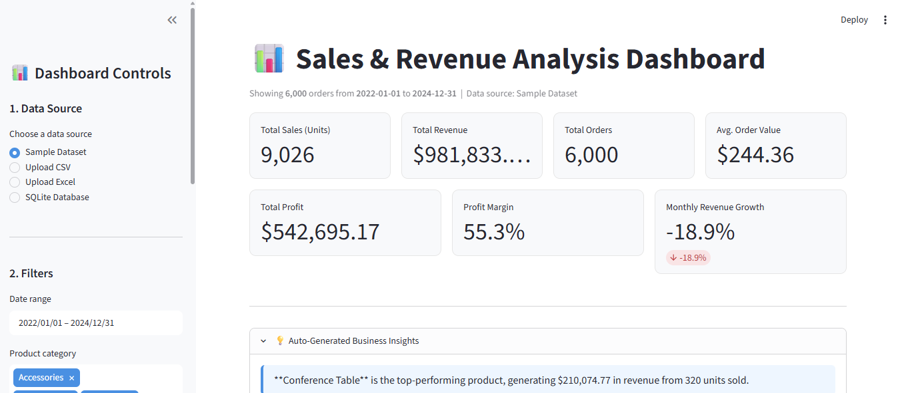
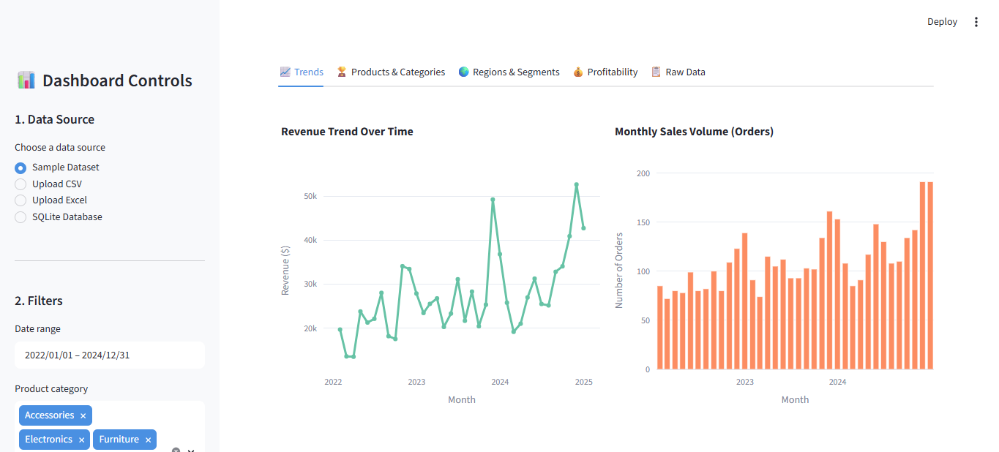
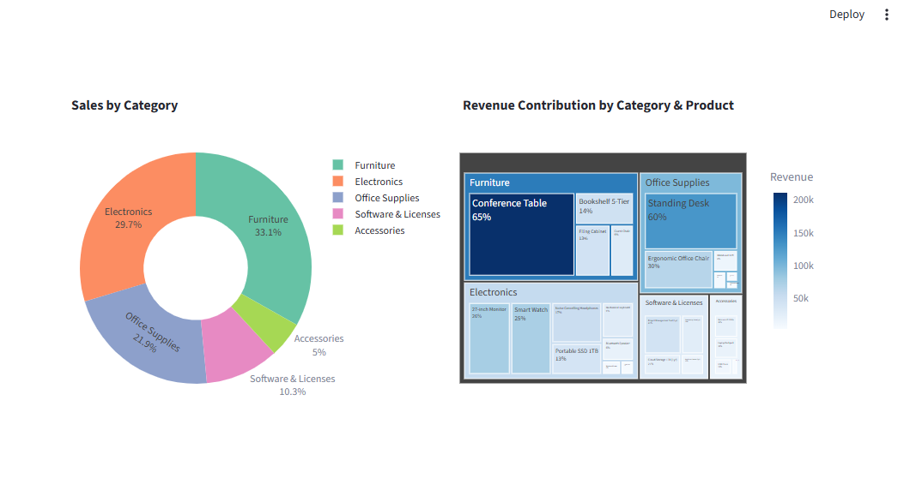
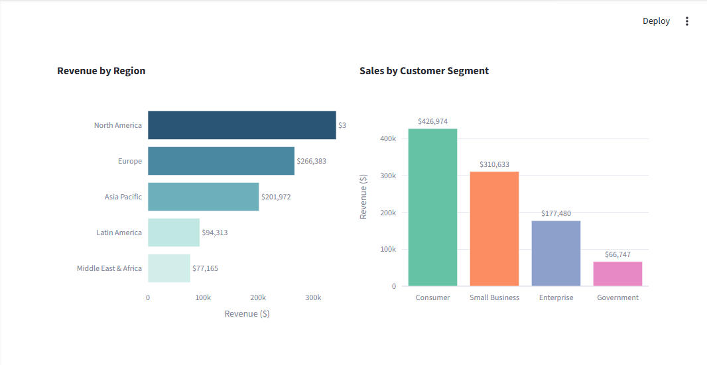
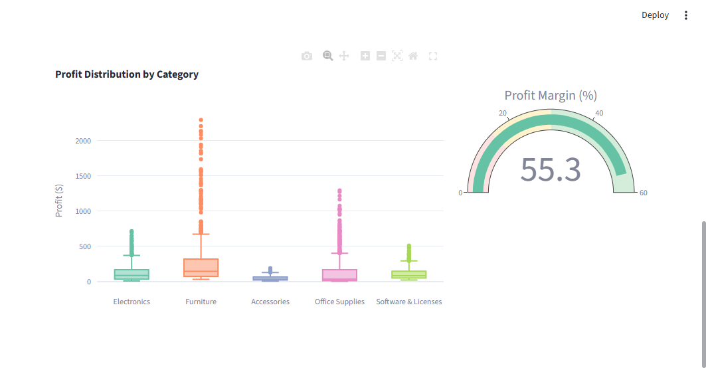

# 📊 Sales & Revenue Analysis Dashboard

An interactive, multi-source **Sales & Revenue Analysis Dashboard** built with
**Python, Pandas, Plotly, and Streamlit**. The dashboard lets you import data
from CSV, Excel, or a SQL database, then explore KPIs, revenue trends, and
top-performing products/regions/categories through interactive charts,
filters, and slicers.

Built as an academic / portfolio data analytics project to demonstrate
**data visualization, KPI tracking, business insight generation, and
dashboard development skills**.

---

## 🧭 Table of Contents

- [Overview](#-overview)
- [Features](#-features)
- [Demo / Screenshots](#-demo--screenshots)
- [Tech Stack](#-tech-stack)
- [Project Structure](#-project-structure)
- [Installation](#-installation)
- [Running the App](#-running-the-app)
- [Using Your Own Data](#-using-your-own-data)
- [Dataset](#-dataset)
- [How the Code is Organized](#-how-the-code-is-organized)
- [Business Insights Engine](#-business-insights-engine)
- [Future Improvements](#-future-improvements)
- [Contributing](#-contributing)
- [License](#-license)

---

## 🔎 Overview

This project simulates a real-world business intelligence tool that a sales
or analytics team might use to monitor performance. It covers the full
analytics workflow:

1. **Ingest** sales data from Excel, CSV, or a SQL database.
2. **Clean & validate** the data with error handling for bad files/columns.
3. **Compute KPIs** — revenue, profit, order volume, growth, margins, etc.
4. **Visualize** trends and comparisons with interactive Plotly charts.
5. **Filter/slice** the data by date, category, region, and segment.
6. **Generate insights** — plain-English, data-driven takeaways.

The app ships with a **realistic synthetic dataset** (3 years, 6,000+
orders, 5 categories, 5 regions, 4 customer segments, seasonality built in)
so it runs out of the box with zero setup.

---

## ✨ Features

### Data Sources
- ✅ Excel (`.xlsx`) import
- ✅ CSV (`.csv`) import
- ✅ SQLite database import (bundled `.db` file)
- ✅ Extensible to MySQL / PostgreSQL via SQLAlchemy connection strings

### KPIs
- Total Sales (units)
- Total Revenue
- Total Orders
- Average Order Value
- Total Profit
- Profit Margin
- Monthly Revenue Growth
- Top Performing Products
- Top Performing Categories
- Best Performing Regions

### Visualizations
- Revenue trend line chart
- Monthly sales volume trend
- Top products bar chart
- Category-wise sales (donut chart)
- Region-wise revenue bar chart
- Profit distribution (box plot)
- Sales by customer segment
- Revenue contribution treemap (category → product)
- Profit margin gauge

### Interactivity
- Date range picker
- Product category multi-select filter
- Region multi-select filter
- Customer segment multi-select filter
- Order status filter (Completed / Returned / Cancelled)
- Product name search box
- Downloadable filtered dataset (CSV)
- Tabbed layout (Trends / Products / Regions / Profitability / Raw Data)

### Robustness
- Friendly error messages for invalid/missing files
- Schema validation (required columns, numeric coercion)
- Graceful handling of empty filter results

---

## 🖼 Demo / Screenshots

### KPI Overview & Business Insights


### Revenue & Sales Trends


### Top Products & Category Breakdown


### Regional & Customer Segment Analysis


### Profitability Analysis


---

## 🛠 Tech Stack

| Layer            | Technology                     |
|-------------------|---------------------------------|
| Language          | Python 3.10+                   |
| Data processing   | Pandas, NumPy                  |
| Visualization     | Plotly Express / Graph Objects |
| Dashboard/UI      | Streamlit                      |
| Database          | SQLite (bundled), SQLAlchemy for MySQL/PostgreSQL |
| File formats      | CSV, XLSX (openpyxl)           |

---

## 📁 Project Structure

```
sales-revenue-dashboard/
├── app.py                      # Main Streamlit application (UI + orchestration)
├── src/
│   ├── __init__.py
│   ├── data_loader.py          # CSV / Excel / SQL loading + validation
│   ├── kpi_calculator.py       # All KPI math (pure functions, unit-testable)
│   ├── visualizations.py       # Plotly chart-building functions
│   └── database.py             # SQLite helpers + connection-string builders
├── utils/
│   └── data_generator.py       # Generates the synthetic sample dataset
├── data/
│   ├── sample_sales_data.csv   # Sample dataset (CSV)
│   ├── sample_sales_data.xlsx  # Sample dataset (Excel)
│   └── sales_database.db       # Sample dataset (SQLite)
├── .streamlit/
│   └── config.toml             # Theme configuration
├── assets/
│   └── screenshots/            # Screenshot placeholders for README
├── requirements.txt
├── .gitignore
├── LICENSE
└── README.md
```

This structure follows a standard **separation-of-concerns** layout: UI code
(`app.py`) never contains business logic directly — it calls into `src/`
modules, which makes the project easier to read, test, and extend.

---

## ⚙️ Installation

### Prerequisites
- Python 3.10 or higher
- pip

### Steps

```bash
# 1. Clone the repository
git clone https://github.com/<your-username>/sales-revenue-dashboard.git
cd sales-revenue-dashboard

# 2. Create a virtual environment (recommended)
python -m venv venv

# Activate it:
# Windows:
venv\Scripts\activate
# macOS/Linux:
source venv/bin/activate

# 3. Install dependencies
pip install -r requirements.txt
```

---

## ▶️ Running the App

```bash
streamlit run app.py
```

Then open the URL Streamlit prints in your terminal (typically
`http://localhost:8501`) in your browser.

The dashboard loads the **bundled sample dataset by default** — no extra
setup required. Use the sidebar to switch to your own CSV, Excel, or
SQLite file at any time.

### Regenerating the sample dataset

If you want a fresh random sample (or want to change the size / date
range), edit the constants at the top of `utils/data_generator.py` and run:

```bash
python utils/data_generator.py
```

This regenerates `data/sample_sales_data.csv` and `data/sales_database.db`.

---

## 📤 Using Your Own Data

The dashboard expects the following columns (matching the sample dataset
schema). If your file uses different column names, rename them to match
before uploading:

| Column | Type | Description |
|---|---|---|
| `OrderID` | text | Unique order identifier |
| `OrderDate` | date | Order date (any standard date format) |
| `CustomerSegment` | text | e.g. Consumer, Small Business, Enterprise |
| `Region` | text | Sales region |
| `ProductCategory` | text | Product category |
| `ProductName` | text | Product name |
| `Quantity` | number | Units sold |
| `UnitPrice` | number | Price per unit |
| `NetRevenue` | number | Revenue after discounts |
| `Profit` | number | Profit for the line item |
| `OrderStatus` | text | Completed / Returned / Cancelled |

Optional columns (`DiscountPercent`, `GrossRevenue`, `DiscountAmount`,
`UnitCost`, `TotalCost`, `SalesRep`, `PaymentMethod`) are used if present
but default gracefully if missing.

**Connecting to MySQL / PostgreSQL:** use
`src/data_loader.load_sql_connection(connection_string, query)` with a
SQLAlchemy connection string (see docstrings in `src/database.py` for
examples). This isn't wired into the file-upload sidebar by default (to
avoid asking users to paste live DB credentials into a public demo app),
but it's ready to call from a script or a custom form.

---

## 🗂 Dataset

The bundled sample dataset (`data/sample_sales_data.csv`) is **fully
synthetic** and generated by `utils/data_generator.py`. It simulates:

- **3 years** of order history (2022–2024)
- **6,000** orders across **5 product categories** and **26 products**
- **5 regions**, **4 customer segments**, **10 sales reps**
- Realistic **seasonality** (holiday-season spikes in Nov/Dec)
- Randomized discounts, order statuses (Completed/Returned/Cancelled),
  and payment methods

This makes every dashboard feature (trend charts, top-N rankings, regional
breakdowns, filters) show meaningful, non-trivial patterns.

---

## 🧩 How the Code is Organized

- **`app.py`** — Streamlit page layout, sidebar filters, and wiring between
  user input and the modules below. Contains no KPI math or chart logic
  directly.
- **`src/data_loader.py`** — Reads CSV/Excel/SQLite, validates schema,
  coerces types, and raises a friendly `DataLoadError` on bad input.
- **`src/kpi_calculator.py`** — Pure, side-effect-free functions that take
  a DataFrame and return a KPI value or summary table. Easy to unit test
  independently of the UI.
- **`src/visualizations.py`** — Builds and returns Plotly `Figure` objects;
  no Streamlit imports, so charts can be reused in a notebook or another
  app.
- **`src/database.py`** — SQLite query helper + connection-string builders
  for MySQL/PostgreSQL.
- **`utils/data_generator.py`** — Synthetic data generation script (also
  a good reference for the expected schema).

---

## 💡 Business Insights Engine

`kpi_calculator.generate_business_insights()` analyzes the currently
filtered dataset and produces plain-English takeaways, for example:

> **Conference Table** is the top-performing product, generating
> $210,074.77 in revenue from 320 units sold.
>
> Revenue declined **18.9%** month-over-month in the most recent period.
>
> Profit margin is healthy at **55.3%**, indicating efficient pricing and
> cost control.

These are shown in an expandable "Business Insights" panel at the top of
the dashboard and update live as filters change — demonstrating basic
automated business-insight generation.

---

## 🚀 Future Improvements

- [ ] Add forecasting (e.g. Prophet / ARIMA) for revenue projection
- [ ] Add cohort / customer lifetime value analysis
- [ ] Add a geographic map visualization (choropleth) for region revenue
- [ ] Add user authentication for multi-user / role-based dashboards
- [ ] Add automated PDF/PowerPoint report export
- [ ] Add unit tests (pytest) for `kpi_calculator.py` and `data_loader.py`
- [ ] Add CI (GitHub Actions) to run tests and linting on push
- [ ] Add native MySQL/PostgreSQL connection form in the sidebar
- [ ] Add anomaly detection for sudden revenue/profit drops
- [ ] Containerize with Docker for one-command deployment

---

## 🤝 Contributing

This is primarily an academic/portfolio project, but suggestions and pull
requests are welcome. To contribute:

```bash
git checkout -b feature/your-feature-name
# make your changes
git commit -m "Add: your feature description"
git push origin feature/your-feature-name
```

Then open a pull request.

---

## 📄 License

This project is released under the MIT License — see [LICENSE](LICENSE)
for details.

---

## 🙋 Author's Note

This project was built as a hands-on exercise in data visualization, KPI
tracking, and business insight generation using Python's data analytics
and dashboarding ecosystem (Pandas, Plotly, Streamlit). Feel free to fork
it, plug in your own dataset, and extend it further.
